# Rede Corporativa com VLANs, Roteamento Inter-VLAN, DHCP e NAT

Rede segmentada para uma empresa fictícia, simulada no Cisco Packet Tracer.

## Objetivo
Uma empresa com três departamentos (TI, Financeiro e Visitantes) precisa
de redes separadas, endereçamento automático e acesso à internet. O projeto
implementa essa estrutura com um switch, um roteador de borda e um
roteador de provedor simulando a internet.

## Conceitos praticados
- **VLAN:** separa departamentos na mesma infraestrutura física.
- **Trunk 802.1Q:** leva várias VLANs por um único cabo até o roteador.
- **Router-on-a-stick:** o roteador usa subinterfaces, uma por VLAN.
- **DHCP:** entrega IP, gateway e DNS automaticamente.
- **NAT com overload:** permite que toda a rede interna saia por um único IP.

## Topologia
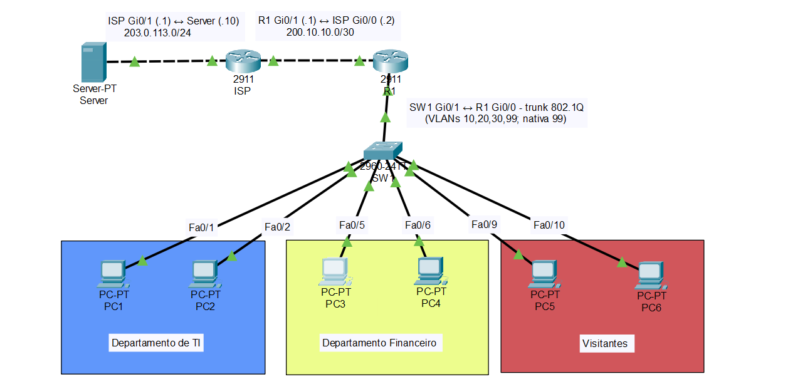

## Endereçamento
| VLAN | Nome | Rede | Gateway | Portas |
|---|---|---|---|---|
| 10 | TI | 192.168.10.0/24 | 192.168.10.1 | Fa0/1-4 |
| 20 | FINANCEIRO | 192.168.20.0/24 | 192.168.20.1 | Fa0/5-8 |
| 30 | VISITANTES | 192.168.30.0/24 | 192.168.30.1 | Fa0/9-12 |
| 99 | GERENCIA | 192.168.99.0/24 | 192.168.99.1 | SVI do SW1 |

Enlace R1-ISP: [200.10.10.0/30] (R1=.1 ISP=.2). Rede do servidor: 203.0.113.0/24 (ISP=.1 Servidor=.10).

## Estrutura do repositório
```
README.md              este arquivo
topologia.png          diagrama da rede
rede-corporativa.pkt   arquivo do Packet Tracer
configs/               configurações exportadas (R1, SW1, ISP)
evidencias/            prints dos testes
```

## Configuração realizada
- **SW1:** criação das VLANs 10, 20, 30 e 99, portas de acesso por
  departamento, trunk para o R1 com VLAN nativa 99.
- **R1:** subinterfaces com encapsulamento dot1Q, pools de DHCP por VLAN,
  NAT com overload e rota padrão para o ISP.
- **ISP e servidor:** servidor com HTTP e DNS (`www.empresa-teste.com`).

Configurações completas em [`configs/`](configs/).

## Como validar
| Teste | Onde | Esperado | Evidência |
|---|---|---|---|
| `show vlan brief` | SW1 | VLANs com as portas corretas | [print](evidencias/01-validacao-vlans.png) |
| `show interfaces trunk` | SW1 | Gi0/1 em trunk | [print](evidencias/02-validacao-trunk.png) |
| DHCP nos PCs | PC1, PC3 e PC5 | IP, gateway e DNS 203.0.113.10 de cada VLAN | [print PC1](evidencias/03.1-validacao-dhcp-pc-TI-fa0-1.png), [print PC3](evidencias/03.2-validacao-dhcp-pc-FINANCEIRO-fa0-5.png), [print PC5](evidencias/03.3-validacao-dhcp-pc-VISITANTES-fa0-9.png) |
| `show ip dhcp binding` | R1 | IPs da faixa de cada VLAN | [print](evidencias/04-validacao-dhcp-binding.png)|
| ping gateway | PC da TI | sucesso | [print](evidencias/05-validacao-ping-gateway.png) |
| ping entre VLANs | PC Financeiro | sucesso | [print](evidencias/06-validacao-ping-intervlan.png) |
| ping internet simulada | PC Financeiro | sucesso | [print](evidencias/07-validacao-ping-web.png) |
| acesso a `www.empresa-teste.com` | PC | página carrega | [print](evidencias/08-validacao-pagina-web.png) |
| `show ip nat translations` | R1 | traduções ativas | [print](evidencias/09-validacao-nat.png) |
| Config do servidor | Server	| IP 203.0.113.10 e registro www.empresa-teste.com | [print](evidencias/10-validacao-dns-server.png) |
| `show ip route` |	R1	| Rota S* 0.0.0.0/0 via 200.10.10.2 |	[print](evidencias/11-validacao-ip-route.png)|
| `show ip interface brief` |	R1	| Subinterfaces .10/.20/.30/.99 e Gi0/1 em up/up |	[print](evidencias/12-validacao-show-ip-interface-brief.png) |
| ping Visitantes → TI| PC5	| sucesso (ainda sem ACL; é bloqueado no Projeto 2) |	[print](evidencias/12-validacao-show-ip-interface-brief.png) |

## Problemas encontrados e soluções
**1. PC do Financeiro estava na porta errada e acessava a VLAN do TI**
- Investigação: `show vlan brief` no SW1 para saber se o erro estava na configuração da VLAN. Após a validação da VLAN, usei `show mac address-table` para validar se a porta estava correta no switch e `ipconfig /all` no pc do Financeiro para descobrir o endereço MAC.
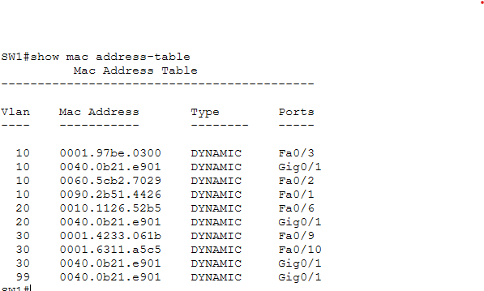
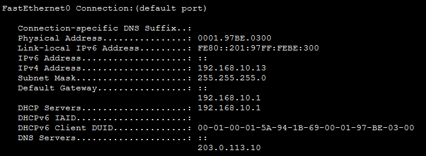
- Causa: estava na porta FastEthernet0/3, que faz parte da VLAN 10.
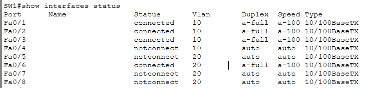
- Solução: porta conectada corretamente FastEthernet0/5.
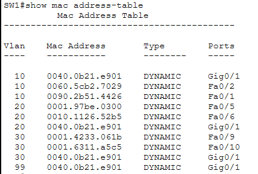

**2. [PC do Financeiro sem IP após remover a VLAN 20 do trunk - teste controlado](evidencias/14.1-teste-controlado-vlan-trunk-removida.png)**
- Investigação: PCs do financeiro não conseguiam se comunicar com nenhuma rede externa e não recebia DHCP, atribuindo automaticamente um endereço APIPA (169.254.3.0). Outras redes continuavam sem problema.
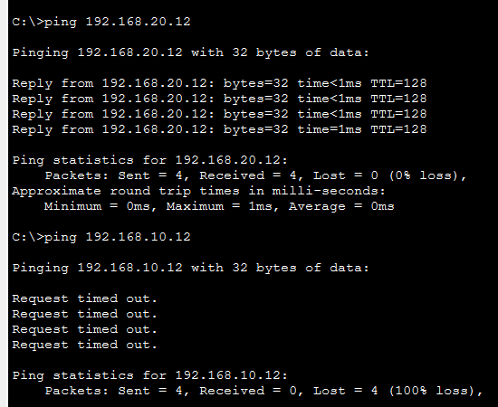
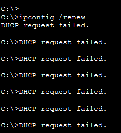
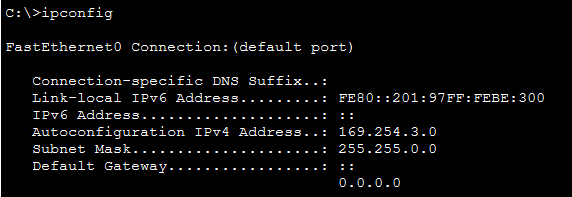
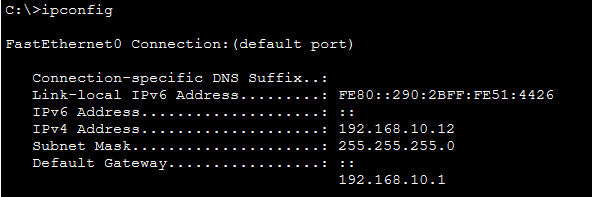
- Causa: `show vlan brief` mostra que a VLAN 20 está ativa e os PCs estão na porta correta (Fa0/5 e Fa0/6), `show interfaces trunk` mostra onde está o problema, a VLAN 20 está ausente das permitidas. `show ip interfaces brief` no R1 mostra que a Gi0/0.20 está normal (up).
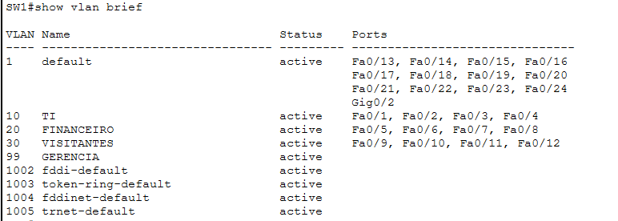
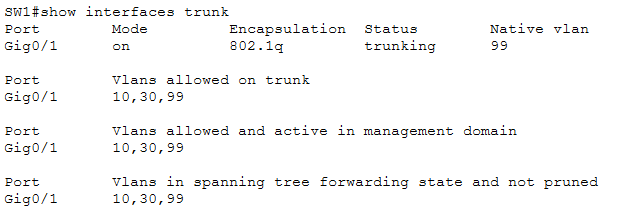
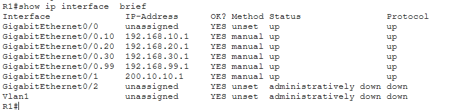
- Solução: Adicionar a VLAN 20 a lista de permissão do trunk.
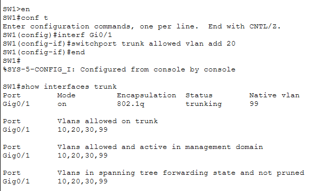 

## Como reproduzir
1. Abra `rede-corporativa.pkt` no Packet Tracer.
2. Aguarde alguns segundos para os links subirem.
3. Execute os testes da tabela acima.

## Aprendizados
Neste projeto configurei tudo pela linha de comando (CLI) e, ao documentar e
testar, aprendi mais do que apenas configurar:

- **Trunk e VLAN nativa:** a VLAN nativa precisa ser igual nos dois lados do
  trunk (99 no SW1 e no R1), e o `switchport trunk allowed vlan` define quais
  VLANs realmente atravessam o cabo.
- **Router-on-a-stick:** cada subinterface do R1 (.10, .20, .30 e .99) é o
  gateway da sua VLAN, e a Gi0/0 física fica sem IP.
- **DHCP e NAT overload:** pools por VLAN com faixa reservada para IPs fixos e
  PAT para toda a rede sair por um único IP público.
- **Teste de falha controlado:** removi a VLAN 20 do trunk de propósito e vi que
  ela continuou "ativa" no `show vlan brief`, porque esse comando mostra o banco
  de VLANs do switch, e não o que passa pelo trunk. Isso só aparece no
  `show interfaces trunk`. Os PCs do Financeiro continuaram se falando entre si,
  mas perderam gateway e DHCP (IP 169.254.x.x), o que mostra o que depende do
  roteador e o que é local ao switch.
- **Diagnóstico do mais perto ao mais longe:** começar pelo PC (`ipconfig`),
  seguir para a porta e a VLAN (`show vlan brief`), depois o trunk
  (`show interfaces trunk`) e só então o roteador. Uma falha mais próxima
  invalida os testes mais distantes, e cada passo elimina uma camada.
- **`vlan.dat`:** as VLANs ficam gravadas na flash do switch e não aparecem no
  `show running-config`. Por isso o `SW1.txt` exportado não reproduz a criação
  delas sozinho. Coloquei o switch em modo VTP transparente, e assim as VLANs passaram a constar no show running-config. Num projeto com um switch só, isso não muda nada no funcionamento
- **Planejamento:** fazer a tabela de endereçamento antes de configurar evitou
  retrabalho.

## Limitações
Este projeto é a base de conectividade e, de propósito, não tem hardening:
1. as VLANs se comunicam entre si, sem ACLs;
2. as portas sem uso continuam ativas na VLAN 1 e não há port security;
3. não há acesso remoto seguro (SSH) configurado;
4. a ACL do NAT é numerada (`access-list 1`) e cobre toda a faixa 192.168.0.0/16, inclusive a VLAN 99 de gerência. 
- Mantive assim para simplificar a base; as limitações são trabalhadas no [Projeto 2](https://github.com/luizwalger/rede-corporativa-acl-ssh-portsecurity).


## Próximos passos
- **Projeto 2 (concluído):** ACLs nomeadas, SSH e port security
  ([rede-corporativa-acl-ssh-portsecurity](https://github.com/luizwalger/rede-corporativa-acl-ssh-portsecurity)).
- **Projeto 3 (planejado):** automação em Python (coleta de comandos `show` e backup das configurações).
- **Evolução da rede (planejado):** DHCP centralizado em servidor dedicado, com DHCP relay (`ip helper-address`) no R1.